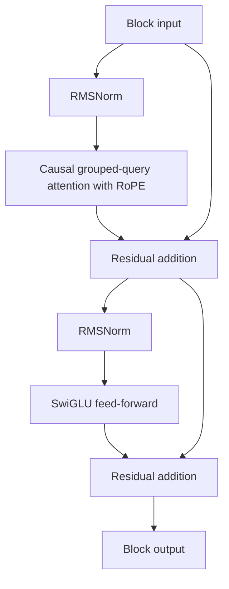

# In-House Legal Intelligence System

**CS781 NLP Capstone · IIT Kanpur**  
Himanshu Yadav · Roll no. 240455

This project trains a small language model from scratch on Indian legal text and adapts it to six downstream tasks. Phase 1 compares six architectures on legal continuation. Model 6, a roughly 200M-parameter causal Transformer, is the starting point for the best submission in each downstream phase.

The project uses the official [CS781 Capstone dataset](https://huggingface.co/datasets/Exploration-Lab/CS-781-Capstone). The data covers Supreme Court and High Court judgments, Acts, Tribunal decisions, and the task-specific splits. See [IL-TUR](https://arxiv.org/abs/2407.05399) for the Indian legal NLP benchmark behind the project.

## Results at a glance

These are the best Codabench test scores reported for each phase. Development metrics used for training and model selection are described in the phase sections below.

| Phase | Task | Best submission | Primary metric | Score |
| --- | --- | --- | --- | ---: |
| 1 | [Legal language modelling](#phase-1-legal-language-modelling) | Model 6, 2B-token run | BERTScore F1 | **0.8355** |
| 2 | [Legal named entity recognition](#phase-2-legal-named-entity-recognition) | Model 6 + LORMA | Strict macro-F1 | **0.6270** |
| 3 | [Rhetorical role prediction](#phase-3-rhetorical-role-prediction) | Model 6 + LoRA | Macro-F1 | **0.5004** |
| 4 | [Court judgment prediction](#phase-4-court-judgment-prediction) | Model 6 + LoRA | Macro-F1 | **0.8086** |
| 5 | [Legal statute identification](#phase-5-legal-statute-identification) | Model 6 + LoRA | Macro-F1 | **0.3766** |
| 6 | [Abstractive summarization](#phase-6-abstractive-summarization) | Model 6 + LORMA | BERTScore F1 | **0.8452** |
| 7 | [Prior case retrieval](#phase-7-prior-case-retrieval) | Model 6 + LoRA | Micro-F1@7 | **0.4654** |

## Run the project

| Phase | Notebook | Experiment for the best method |
| --- | --- | --- |
| 1 | `nb2_gqa_swa_2B_from_scratch.ipynb` | `gqa_swa` |
| 2 | `phase2_lner_all_methods.ipynb` | Experiment 2, `lorma` |
| 3 | `phase3_rr_all_methods.ipynb` | Experiment 1, `lora` |
| 4 | `phase4_cjpe_all_methods.ipynb` | Experiment 1, `lora` |
| 5 | `phase5_lsi_all_methods.ipynb` | Experiment 1, `lora` |
| 6 | `phase6_summ_all_methods.ipynb` | Experiment 2, `lorma` |
| 7 | `phase7_pcr_all_methods.ipynb` | Experiment 1, `lora` |

1. Clone the repository and open the notebook for the phase you want to run.

   ```bash
   git clone https://github.com/Himanshu-738/CS781-Capstone-Legal-Language-Model-Challange.git
   ```

2. Use a Kaggle GPU session. The notebooks read inputs under `/kaggle/input` and write outputs to `/kaggle/working`. The main dependencies are PyTorch, NumPy, `huggingface_hub`, `tqdm`, and scikit-learn. Phase 1 uses `ijson` to stream the corpus and `bert-score`, `rouge-score`, and `sacrebleu` for the continuation evaluator. Phase 6 also uses `rouge-score`.
3. Set up access to the official Hugging Face dataset. Use a Kaggle secret named `HF_TOKEN` for Phase 1 and `HF` for Phases 2–3. Phases 4–7 check both names. The notebooks also support the `HF_TOKEN` environment variable.
4. Run Phase 1 from top to bottom. Attach the course `evaluate_phase1.py` script for local continuation scoring and the decoding sweep. If training reaches the session time limit, save the run outputs and attach them to the next session. The same notebook can restore the data and resume training.
5. For any downstream phase, attach the matching `gqa_swa_best.pt` and `bpe_legal_16k_v2.pkl` under `/kaggle/input`. Phase 1 writes them under `/kaggle/working/cs781_phase1/checkpoints_v3/` and `/kaggle/working/cs781_phase1/tokenizer/`, respectively. Phases 2–7 start independently from this checkpoint, so they can run in any order.
6. Each downstream notebook runs its experiment variants and writes a separate ZIP per method. Use the ZIP for the method listed above. For distillation, keep the teacher experiments that run earlier in the same notebook.

## Phase 1: Legal language modelling

### Task and model comparison

The input is a legal prompt of 512 words. The model generates a 128-word continuation. Training starts from random weights.

| Architecture | Design | BERTScore F1 |
| --- | --- | ---: |
| Decoder-only | 12 causal blocks, width 768, 12 attention heads, rotary positions, pre-RMSNorm, and a 2,048-wide SwiGLU layer. | 0.8292 |
| Encoder–decoder | Six encoder layers read the prompt. Six causal decoder layers generate the continuation using cross-attention to the encoder. Both stacks use width 512, eight heads, and learned absolute positions. | 0.8298 |
| Hybrid | 12 blocks alternate 256-token local attention and GRUs. Each block also has a SwiGLU feed-forward layer. | 0.8336 |
| Custom legal encoder | A 110M-parameter bidirectional Transformer with 12 layers, width 768, 12 heads of width 64, and a 3,072-wide GELU feed-forward layer. It uses pre-LayerNorm, residuals, a 30,522-token legal WordPiece vocabulary, and token, segment, and absolute position embeddings for sequences of up to 512 tokens. Segment embeddings support next-sentence prediction. | 0.8333 |
| Efficient Base | The roughly 100M-parameter baseline for the efficient model family. | 0.8290 |
| Model 6 | A 197.17M-parameter decoder with grouped-query attention and alternating local and global causal blocks. | **0.8355** |

### Model 6 architecture

| Component | Setting |
| --- | --- |
| Hidden size and depth | 1,024 channels, 16 decoder blocks |
| Attention | 16 query heads, four key/value heads, 64 channels per head |
| Attention pattern | Three 256-token sliding-window blocks followed by one full causal block, repeated four times |
| Positions | Rotary position embeddings (RoPE) on queries and keys |
| Feed-forward layer | SwiGLU with inner width 2,816 |
| Normalization and residuals | RMSNorm before each sublayer, residual addition after it, and a final RMSNorm |
| Tokenizer and head | 16,384-token case-sensitive BPE vocabulary, with shared embedding and output weights |
| Trainable parameters | 197,166,080 at a vocabulary size of 16,384 |

Four query heads share each key/value head. The local mask includes the current token and up to 255 earlier positions. Blocks 4, 8, 12, and 16 attend to the entire prefix.



### Corpus and tokenization

The BPE tokenizer learns from case-sensitive samples of about 2,000 characters. It keeps spaces and punctuation and can split names, citations, and unfamiliar words into smaller pieces. Tokenizer training targets 8,000 Supreme Court documents, 6,000 High Court documents, 4,000 Acts, and 2,000 Tribunal documents.

| Source | Initial share | Target tokens |
| --- | ---: | ---: |
| Supreme Court | 40% | 800M |
| High Courts | 30% | 600M |
| Acts | 20% | 400M |
| Tribunals | 10% | 200M |

These are Model 6's starting quotas. High Courts take unused quota from the other sources. The preprocessing streams JSON, appends an end-of-sequence token to each document, and writes the token IDs to a memory-mapped `uint16` file. The training loader shuffles 1,024-token blocks. The first 1,023 tokens are inputs and the last 1,023 are the shifted targets. The run records the realized source counts in `train_mix_stats_2B.json`.

### Training and evaluation

- **Budget.** Four blocks per microbatch and 16 accumulation steps give 65,536 nominal block tokens per update. The schedule targets 30,518 steps, or about 2B block tokens.
- **Optimizer.** Muon updates the internal weight matrices at a peak learning rate of `0.02`. AdamW updates embeddings and the remaining parameters at `4e-4`, with betas `(0.9, 0.95)` and weight decay `0.05` on its decay group. Both schedules use 5% warmup and cosine decay with a 5% floor.
- **Memory and recovery.** Training uses FP16 autocast, gradient scaling, gradient checkpointing, and gradient clipping at 1.0. It saves a resumable checkpoint every 250 steps and evaluates every 500. It compares the raw weights with an exponential moving average with decay 0.995. The checkpoint with the lowest validation loss is exported as `gqa_swa_best.pt`. A paused training run resumes from the saved model, optimizer, scheduler, and scaler states.
- **Holdout.** Hashes of the last 3,000 records from each of the Supreme Court and High Court corpora exclude matching documents from BPE training and the pretraining corpus. Up to 200 eligible documents per source supply a 512-word prompt and its next 128 words. Longer held-out text supplies full blocks for validation loss and perplexity.
- **Decoding.** A 20-prompt subset compares four combinations of temperature, nucleus sampling, and repetition penalty. Selection uses BERTScore F1 when available. Test decoding adds top-`k = 50` and generates up to 320 new BPE tokens. The prompt keeps its most recent tokens when it needs to leave room for the continuation. The formatter keeps exactly 128 whitespace-delimited words. Short outputs use `the` as a fallback. Partial predictions are saved every 25 examples under a name tied to the checkpoint step.

**Submission.** `submission_gqa_swa_2B.zip` contains a mapping from each test ID to an object with a `text` field. The best run scored 0.8355 BERTScore F1, 0.1885 ROUGE-L F1, and 0.0480 BLEU-4.

```json
{"test_id": {"text": "The generated continuation goes here."}}
```

## Shared downstream setup

Each experiment loads the same Phase 1 Model 6 weights and tokenizer, then adds the task-specific head or decoding setup. For a pretrained linear layer with input `x` and output `h = Wx`, LoRA adds a low-rank correction based on `x`. LORMA applies the correction to `h`. The adapters scale their updates by `alpha / rank`. The projection targets and trainable normalization layers vary by task.

Each phase compares LoRA, LORMA, a `full` fine-tuning variant, and distillation. Phases 2–3 keep the backbone depth and use lower-rank student adapters. Phases 4–7 take every second Model 6 block for an eight-layer student. Phases 2, 3, 6, and 7 use the corresponding `full` variant as teacher. Phases 4–5 choose the best preceding variant by development macro-F1. The `full` variants for Phases 6–7 update the top four blocks and final RMSNorm. Phase 6 also updates the tied language-model head.

### Experiment variants

The downstream notebooks name the four experiments `lora`, `lorma`, `full`, and `distillation`, in that order. The table lists the adapter targets. Here, attention means the query, key, value, and output projections unless a subset is named.

| Phase | LoRA | LORMA | Distillation target |
| --- | --- | --- | --- |
| 2 | Rank 8, attention and feed-forward | Rank 16, attention and feed-forward | Token logits |
| 3 | Rank 8, query, value, and feed-forward | Rank 16, attention | Role logits |
| 4 | Rank 8, attention and feed-forward | Rank 8, attention | Binary outcome logits |
| 5 | Rank 8, attention and feed-forward | Rank 8, attention | Independent statute probabilities |
| 6 | Rank 8, attention and feed-forward | Rank 8, attention | Next-token vocabulary logits |
| 7 | Rank 16, attention and feed-forward | Rank 16, attention | In-batch similarity scores |

For Phases 4–5, LoRA also trains the final RMSNorm. LORMA trains the attention norms and final RMSNorm. The distillation students in these two phases use attention LoRA and unfreeze the final two student blocks. Phase 7 LoRA trains both block norms and the final RMSNorm. Phase 6 freezes the wrapped projection weights while leaving the unwrapped parameters trainable.

## Phase 2: Legal named entity recognition

**Input and output.** The input is a full legal document. The output is a set of typed character spans. The label set is `APP`, `RESP`, `A.COUNSEL`, `R.COUNSEL`, `JUDGE`, `WIT`, `AUTH`, `COURT`, `STAT`, `PREC`, `DATE`, and `CASENO`.

**Data.** Train on the two labelled folds in `Phase_2_LNER`, holding out the last eight fold-2 documents after sorting their IDs. Fold 3 is the official test set.

**Architecture.** Model 6 uses bidirectional attention for tagging. It reads 512-token windows with a 256-token stride. A linear head maps each token state to one of 25 BIO states, with one outside state and beginning/inside states for the 12 types. A linear-chain CRF learns transition scores and constrains the tag sequence.

**Alignment and decoding.**

1. Record each BPE token's start and exclusive end in the original document. Trim whitespace from the recorded bounds without modifying the text.
2. Assign a gold entity to each covered token. When two spans compete for a token, choose the one with the larger character overlap.
3. Average the logits for tokens shared by several windows, giving more weight to the center of each window. Tune the outside-tag penalty and punctuation trimming on the development fold. A larger penalty lowers the outside-tag score and makes entity predictions easier to select.
4. Use Viterbi to select one document-level BIO sequence. Convert each entity back to a half-open character span using the first and last nonempty token bounds. Remove duplicate spans.

**Best run.** LORMA with alpha 32. The adapter LR is `3e-4`, the head LR is `5e-4`, and the batch size is eight windows. AdamW uses weight decay 0.01, 6% warmup, and linear decay to a 5% floor. Training runs for up to eight epochs and reloads the best strict macro-F1 checkpoint. A rank-4 LoRA student distils the full tagger's token logits at temperature 3.

**Submission.** `submission_exp2_lorma.zip` maps each document ID to a list of `[start, end, label]` triples. Strict scoring requires the label and both offsets to match. The best scores were 0.6270 strict macro-F1, 0.6453 strict macro-precision, and 0.6341 strict macro-recall.

```json
{"document_id": [[0, 12, "COURT"], [33, 44, "STAT"]]}
```

## Phase 3: Rhetorical role prediction

**Input and output.** Assign one discourse role to each sentence of a legal case, such as a fact, issue, argument, or ruling. The result preserves the order of the supplied sentences.

**Data and context.** `Phase_3_RR` supplies Corporate Law and Information Technology train, development, and test sets. Both domains use one classifier and one label vocabulary. For each target sentence, pack its preceding sentence, the target, and its following sentence with boundary tokens between them. Keep the first 256 tokens. A long preceding sentence can reduce the amount of target and right context that fits.

**Architecture.** The causal Model 6 backbone encodes each packed input. The classifier averages the non-padding hidden states and predicts one role independently per target sentence. The training loss is cross-entropy weighted by inverse label frequency. Argmax gives the predicted role, and the output writer restores the original sentence order within each case.

**Best run.** LoRA with alpha 16. Train for three epochs with AdamW at `5e-4`, weight decay 0.01, and batch size 16. Evaluate macro precision, recall, and F1 on the pooled development set. The final epoch supplies test predictions. The best full fine-tuning checkpoint supplies the teacher for a rank-4 LoRA student at temperature 3.

**Submission.** `submission_exp1_lora.zip` maps document IDs to ordered lists of role labels. The best scores were 0.5004 macro-F1, 0.5021 macro-precision, and 0.5193 macro-recall.

```json
{"document_id": ["Fact", "Issue", "RulingByPresentCourt"]}
```

## Phase 4: Court judgment prediction

**Input and output.** Predict the binary outcome from the case text in `Phase_4_CJPE`. Class 0 is rejected and class 1 is accepted.

**Long documents.** Split the text into overlapping 512-token windows, including begin and end markers. Window starts are 448 content positions apart. Keep the start and end windows, with up to two windows for training and four for development and test.

**Architecture.** Encode each window separately using Model 6. Concatenate the mean, maximum, and end-of-sequence token states and project them to one window vector. A gated attention layer weights the windows. Concatenate the attention-weighted average with the ordinary window average and feed the result to a two-class head. The model uses the case text as input.

**Best run.** LoRA with alpha 16. Train for two epochs with batch size 16, two accumulation steps, backbone LR `3e-4`, and head LR `5e-4`. The optimizer uses 10% warmup and cosine decay with a 5% floor. Weighted cross-entropy uses inverse class-frequency weights and 0.03 label smoothing. Sweep the class-1 softmax threshold from 0.20 to 0.80 in steps of 0.01 and keep the checkpoint and threshold with the best development macro-F1. The eight-block distillation student learns from cached teacher logits at temperature 2.

**Submission.** `submission_exp1_lora.zip` contains a list of test IDs and binary predictions. The best scores were 0.8086 macro-F1, 0.7935 precision, and 0.8373 recall.

```json
[{"id": "case_id", "pred": 1}]
```

## Phase 5: Legal statute identification

**Input and output.** Predict all applicable statute IDs for each legal case in `Phase_5_LSI`. The label columns map to the numeric statute IDs found in the labelled splits.

**Long documents and head.** Build 512-token windows with starts 384 content positions apart. Select up to three evenly spaced windows for training and four for evaluation. For very long cases, sample from the head, middle, and tail before tokenization. Form a vector from each window's mean, maximum, and end-of-sequence states. Fuse the window vectors using gated attention, max pooling, and mean pooling. A linear head produces one logit per statute. During training, the head averages logits from dropout rates 0.1 through 0.5 before applying the multi-label loss. At inference, each logit maps to its own sigmoid score.

**Loss and calibration.** Use weighted binary cross-entropy. The positive weight is the square root of the negative-to-positive count ratio, clipped to `[1, 15]`. Initialize classifier biases from the training label frequencies. On development data, search a global threshold and per-statute thresholds from 0.15 to 0.85. Statutes with fewer than two positive development examples use the global threshold. Keep the per-statute settings if they match or improve development macro-F1. If every score falls below its threshold, return the highest-scoring statute.

**Best run.** LoRA with alpha 16, backbone LR `3e-4` and head LR `5e-4`. Use batch size 16, two accumulation steps, 10% warmup, and cosine decay with a 5% floor. The schedule uses two epochs above 20,000 training cases and three otherwise. Restore the best development macro-F1 checkpoint and its saved thresholds. The eight-block student distils cached soft sigmoid targets at temperature 2.

**Submission.** `submission_exp1_lora.zip` contains a list of test IDs and lists of statute IDs. The best scores were 0.3766 macro-F1, 0.4791 micro-F1, and 0.0376 subset accuracy.

```json
[{"id": "case_id", "pred": [12, 57]}]
```

## Phase 6: Abstractive summarization

**Input and output.** Generate a summary of each judgment in `Phase_6_Summ`. The training set is shuffled with seed 42 and split 85% for training and 15% for development.

**Prompt and target.** Use the causal decoder with a `Document: … Summary:` prompt. If a judgment exceeds 768 source tokens, keep the first and last 384. The training target uses up to 256 tokens including the end-of-sequence token. Shifted next-token cross-entropy covers the summary tokens and masks the prompt and padding.

**Best run.** LORMA with alpha 16. Train for four epochs with AdamW at `3e-4`, weight decay 0.01, and batch size four. The development loop reports stemmed ROUGE-1 and ROUGE-L on up to 20 cases per epoch. The eight-block distillation student uses the top-four-block fine-tuning variant as teacher and matches vocabulary logits at temperature 2.

**Decoding.** The implementation defaults to greedy generation, a repetition penalty of 1.2, and a limit of 128 new tokens. The LORMA implementation applies adapter dropout during generation. The submitted test summaries ranged from 227 to 365 words. The generation limit above describes the default configuration.

**Submission.** `submission_exp2_lorma.zip` contains one summary per test ID. The best scores were 0.8452 BERTScore F1, 0.5375 ROUGE-1 F1, and 0.2692 ROUGE-L F1.

```json
[{"id": "case_id", "summary": "The court considered the appeal and set out its reasoning."}]
```

## Phase 7: Prior case retrieval

**Input and output.** Rank the candidate cases for each query in `Phase_7_PCR` and return seven candidate IDs. Each split supplies its own query set and candidate pool. Training uses the labelled relevant candidate IDs.

**Architecture.** One shared Model 6 backbone encodes queries and candidates separately. Join sentence lists into text, add boundary tokens, and keep the first 512 BPE tokens. Mean-pool the non-padding hidden states and L2-normalize the vector. The dot product between these unit vectors is cosine similarity.

**Training and ranking.** Make one positive pair for each query–relevant-candidate match. Use symmetric in-batch contrastive loss in the query-to-candidate and candidate-to-query directions, with temperature 0.05. Mask off-diagonal pairs that repeat the same query ID or candidate ID. For evaluation, encode each candidate once and rank it by its cosine similarity to the query. Compute micro-precision, micro-recall, and micro-F1 at seven by pooling counts over all queries.

**Best run.** LoRA with alpha 32. Train for six epochs using AdamW at `3e-4`, weight decay 0.01, and batch size eight positive pairs. Use 6% warmup, cosine decay with a 1% floor, and gradient clipping at 1.0. Restore the weights from the epoch with the best development micro-F1@7. The eight-block student distils the teacher's in-batch similarity scores.

**Submission.** `submission_exp1_lora.zip` maps each query ID to seven ranked candidate IDs. The best scores were 0.4654 micro-F1@7, 0.4750 precision@7, and 0.4563 recall@7.

```json
{"query_id": ["cand_1", "cand_2", "cand_3", "cand_4", "cand_5", "cand_6", "cand_7"]}
```

## Submission checks

- Package `prediction.json` at the root of the ZIP. The examples above use illustrative IDs and values.
- Use the official test IDs exactly. Keep IDs with leading zeros as strings.
- In Phase 1, verify that every continuation has 128 words. In Phase 2, verify that each span lies within the original document. In Phase 3, verify that the number and order of labels match the supplied sentences.
- In Phase 4, use an integer class of 0 or 1. In Phase 5, use numeric statute IDs. In Phase 7, return seven distinct IDs from the corresponding candidate pool.
- Phases 2–7 reuse ZIP names across notebooks, such as `submission_exp1_lora.zip`. Keep outputs in separate phase directories so the ZIP and its matching checkpoint remain identifiable.

## References

- [IL-TUR: Benchmark for Indian Legal Text Understanding and Reasoning](https://arxiv.org/abs/2407.05399)
- [LoRA: Low-Rank Adaptation of Large Language Models](https://arxiv.org/abs/2106.09685)
- [LORMA](https://arxiv.org/abs/2506.07621)
- [Distilling the Knowledge in a Neural Network](https://arxiv.org/abs/1503.02531)
